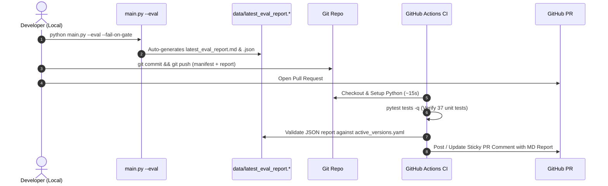

# Infrastructure & Evaluation Automation Improvements History

This document catalogs the engineering, tooling, infrastructure, telemetry, and CI/CD automation built to support rigorous, deterministic, and cost-effective evaluation of the TechStore multi-agent customer support system.

---

## 1. Executive Summary & Infrastructure Evolution

To move beyond manual spot-checking, the testing framework was transformed from basic stdout scripting into an automated, four-pillar evaluation platform:

```
  Phase 1: Local Ad-hoc Scripts      Phase 2: LangSmith & Code Evaluators    Phase 3: Production Quality Gate & CI
┌───────────────────────────────┐   ┌───────────────────────────────────┐   ┌─────────────────────────────────────┐
│ • Sequential stdout execution │   │ • Idempotent LangSmith sync       │   │ • Per-agent version specs & manifest│
│ • Basic pass/fail checks      │──>│ • 5 Deterministic code evaluators │──>│ • Quality Gate & baseline regression│
│ • Unbounded execution time    │   │ • Concurrent evaluation runner    │   │ • Financial cost & TTFT tracking    │
│ • Prone to terminal freezing  │   │ • Isolated QA testing target      │   │ • Decoupled $0 GitHub Actions CI    │
└───────────────────────────────┘   └───────────────────────────────────┘   └─────────────────────────────────────┘
```

---

## 2. Infrastructure & Tooling Milestones

### 2.1 Live Telemetry & Progress Logging
- **Flushed Output Execution**: Enhanced [src/pipeline/evaluator.py](src/pipeline/evaluator.py) with explicit `flush=True` on every step output. This eliminated terminal deadlocks on Windows PowerShell (such as QuickEdit selection pausing).
- **Per-Agent Step Metrics**: Implemented `AgentStepMetrics` to capture input tokens, output tokens, tool call duration, and step elapsed time at each stage of the multi-agent orchestration.

### 2.2 LangSmith Dataset Synchronization
- **Deterministic Example UUIDs**: Built [src/pipeline/langsmith_eval.py](src/pipeline/langsmith_eval.py) using UUIDv5 hashed from scenario IDs (e.g., `EVAL-001`). Syncing with `python main.py --sync-dataset` is fully idempotent—updating existing test examples without creating orphaned duplicates.
- **Dataset Versioning**: Managed the 23-scenario evaluation benchmark ([data/eval_dataset.jsonl](data/eval_dataset.jsonl)) with automated coverage documentation ([data/eval_coverage.md](data/eval_coverage.md)).

### 2.3 Deterministic Code Evaluators
Rather than relying on non-deterministic LLM-as-a-Judge for standard functional checks, 5 client-side Python evaluators were built for fast, zero-token evaluation:
1. **`categoria_match`**: Verifies predicted ticket routing against ground truth.
2. **`especialista_match`**: Asserts the correct specialist agent was invoked.
3. **`escalado_match`**: Audits whether the system correctly escalated to a human or resolved autonomously.
4. **`tool_trajectory_match`**: Validates the exact ordered sequence and arguments of tools called.
5. **`qa_quality_gate`**: Evaluates QA agent decisions, rewrite loops, and rejection of adversarial drafts.

### 2.4 Reusable Evaluation Targets & Concurrency
- **Unified Pipeline Target**: Created `make_pipeline_target()` wrapping `procesar_ticket()` for native integration with `langsmith.evaluate()`.
- **Target Isolation**: Added `make_qa_pipeline_target()` to evaluate the QA agent in isolation against synthetic pre-generated drafts, decoupling QA grading from upstream agent latency.
- **Concurrent Runner**: Integrated `--max-concurrency <N>` in CLI to parallelize API requests across scenarios during cloud evaluations.

---

## 3. Production Architecture & Quality Guardrails

### 3.1 Per-Agent Specifications Architecture
- **Problem**: Monolithic `specs/v1`, `specs/v2`, `specs/v3` bundles prevented evaluating incremental improvements to a single agent (e.g., testing `devoluciones: v4` while keeping others at `v3`).
- **Solution**: Restructured YAML specifications into granular per-agent directories:
  ```
  src/agents/specs/
  ├── active_versions.yaml     # Single source of truth for production versions
  ├── triaje/
  │   ├── v1.yaml, v2.yaml, v3.yaml
  ├── devoluciones/
  │   ├── v1.yaml, v2.yaml, v3.yaml
  ├── soporte_tecnico/
  │   ├── v1.yaml, v2.yaml, v3.yaml
  ├── consultas/
  │   ├── v1.yaml, v2.yaml, v3.yaml
  └── qa/
      ├── v1.yaml, v2.yaml, v3.yaml
  ```
- **Dynamic Resolution**: Updated `src/agents/registry.py` and `src/pipeline/orchestrator.py` to support explicit per-agent version overrides (e.g., `--versions "devoluciones:v4,qa:v3"`).

### 3.2 Automated Quality Gate & Regression Guard
Built [src/pipeline/quality_gate.py](src/pipeline/quality_gate.py) to programmatically enforce quality thresholds before any model or prompt change can merge:
- **Hard Gate Checks**:
  - `escalation_accuracy >= 95.0%`
  - `mean_qa_politica >= 4.50 / 5.0`
- **Primary Winner Target**: `pass_rate >= 85.0%`
- **Tie-Breaker Target**: `first_pass_qa_approval_rate >= 80.0%`
- **Baseline Regression Comparison**: Compares candidate runs against committed production baseline ([data/baseline_pipeline.json](data/baseline_pipeline.json)), applying the configured regression tolerances to comparable benchmarks.
- **CLI Commands**:
  - Run with gate enforcement: `python main.py --eval --fail-on-gate` (LangSmith)
  - Promote new baseline: `python main.py --eval --update-baseline`

### 3.3 Financial Cost & TTFT Latency Telemetry
- **Model Pricing Engine**: Created [src/llm/pricing.py](src/llm/pricing.py) computing real-time dollar cost per ticket across prompt and completion tokens (e.g., `gemini-1.5-flash`: \$0.075 / 1M prompt, \$0.30 / 1M completion).
- **Time to First Token (TTFT)**: Instrumented `avg_ttft_seconds` measuring pre-streaming elapsed latency until model output begins.
- **Reporting Integration**: Wired `avg_cost_usd` and `avg_ttft_seconds` directly into `SUMMARY_METRICS`, `COST_METRICS`, CLI logs, and `GateReport`.

---

## 4. Decoupled Zero-LLM CI/CD Workflow

### 4.1 Architecture & Threat Modeling
Executing full 23-scenario LLM evaluations inside GitHub Actions CI introduces major friction:
- **High Token Costs**: Running evaluations on every PR push rapidly burns LLM token budgets.
- **API Secret Exposure**: CI runners require full API access to LLM providers.
- **Rate Limiting & Flakiness**: Concurrent CI builds risk hitting LLM provider rate limits and timeouts.

### 4.2 The Developer-First PR Workflow
The workflow was decoupled so that **evaluation runs locally** while **CI validates artifacts in 15 seconds for $0**:



### 4.3 CI Guarantees (.github/workflows/eval-gate.yml)
1. **Zero LLM Token Spend in CI**: Uses no external API keys or cloud tokens.
2. **Fast Execution**: Completes in ~15-20 seconds.
3. **Artifact Integrity Verification**: Validates the active agent versions, full scenario coverage, runtime and benchmark fingerprints, and a passing gate. It also checks that the Markdown matches the JSON report.
4. **Transparent Sticky PR Comment**: Automatically renders `data/latest_eval_report.md` as a formatted GitHub PR comment, presenting all metrics and Quality Gate checks to reviewers.

---

### Evaluation comparability

The benchmark now enforces scenario-specific tool calls, tool results, selected reply details, and QA thresholds. The [coverage matrix](data/eval_coverage.md#executable-assertions-and-manual-review) identifies criteria that still require manual review.

LangSmith CLI evaluations seed a fresh SQLite database with a fixed reference date. This keeps return-window fixtures stable across runs. Knowledge-base searches also require an exact match for reported hyphenated error codes, which changes the evidence available to every prompt version.

When the evaluation method changes, start the candidate run with a fresh baseline path. Archive the resulting JSON under [data/baselines](data/baselines) and index it in the [baseline history](AGENT_IMPROVEMENTS_HISTORY.md#4-baseline-history). Update the [active baseline](data/baseline_pipeline.json) when the candidate is promoted.

## 5. Summary of Automated CLI Workflows

| Task | Command | Artifacts Produced / Checked |
|:---|:---|:---|
| Run unit & integration test suite | `pytest tests -q` | 37 tests passing in ~6s |
| Run the full LangSmith evaluation | `python main.py --eval --fail-on-gate` | `data/latest_eval_report.md`, `data/latest_eval_report.json` |
| Test candidate agent version | `python main.py --eval --versions "<agent>:<ver>"` | Candidate evaluation output |
| Save passing candidate metrics | `python main.py --eval --baseline outputs/candidate.json --update-baseline` | Candidate snapshot for review and promotion |
| Synchronize LangSmith dataset | `python main.py --sync-dataset` | Updated LangSmith cloud benchmark |
| Run a smoke test | `python main.py --eval --limit 3` | Filtered LangSmith results and reports under `outputs/` |
| Decoupled GitHub Actions validation | Auto on PR / push to main | Sticky PR comment with metrics summary |
