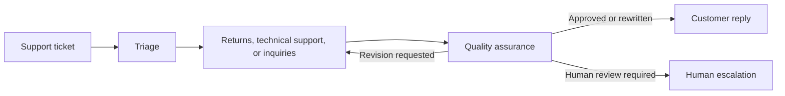

# TechStore Multi-Agent Customer Support

TechStore is an evaluated multi-agent support pipeline for Spanish-language customer tickets. It routes each request to a specialist for returns, technical support, or customer inquiries, then reviews the draft before releasing a reply or escalating the case. The demo runs on synthetic customer, order, and incident data.

The promoted LangSmith run passed **22 of 23 scenarios** with **100% escalation accuracy**. It averaged **20.9% fewer tokens per scenario** than the previous all-v4 run. The [benchmark results](#benchmark-results) show the full comparison and where the evaluation changed.

**Stack** · Python 3.12, LangChain, LangGraph, OpenAI, Pydantic, SQLAlchemy, SQLite, LangSmith, pytest, and GitHub Actions.

## How it works



Triage produces a structured classification and Python selects the specialist. QA checks accuracy, policy compliance, tone, and completeness. The pipeline can send a draft back for revision or route the ticket to a human. [Project specification](SPECIFICATIONS.md)

## How the system is built

| Area | Implementation |
| --- | --- |
| Agent orchestration | Pydantic schemas define the handoffs between triage, specialists, and QA. Python handles routing, bounded revisions, and escalation. [Orchestrator](src/pipeline/orchestrator.py) |
| Tool authorization | Order and return tools take the authorized customer identity from ticket-scoped runtime context and check order ownership. Label creation also rechecks return eligibility. [CRM tools](src/tools/crm.py) · [Returns tools](src/tools/devoluciones.py) |
| Token efficiency | Triage and Inquiries reuse a verified customer snapshot. Triage receives the verified segment and can look up the latest order when needed. QA can approve a draft without generating it again. [Ticket context](src/pipeline/context.py) · [QA prompt](src/agents/specs/qa/v4.yaml) |
| Failure recovery | If response generation truncates after the returns tool has persisted a label, the pipeline builds a QA draft from the verified result. Provider-reported usage from failed calls counts toward token totals. [Agent middleware](src/agents/registry.py) · [Telemetry](src/pipeline/orchestrator.py) |
| Evaluation and release | Deterministic evaluators check routing, escalation, tool calls, and scenario-specific outcomes. Prompt versions live in YAML. GitHub Actions validates the saved report against the evaluated versions and source before a baseline promotion is merged. [Evaluators](src/pipeline/langsmith_eval.py) · [CI workflow](.github/workflows/eval-gate.yml) |

## Quick start

With Python 3.12 on your `PATH`, run these commands from the repository root in PowerShell.

```powershell
python -m venv .venv
.\.venv\Scripts\python.exe -m pip install -r requirements.txt
```

Create a local `.env` file with your OpenAI API key. SQLite is created and seeded automatically on the first ticket run.

```dotenv
OPENAI_API_KEY=your-openai-api-key
```

Run a sample shipping inquiry. This command calls the model.

```powershell
.\.venv\Scripts\python.exe main.py --mensaje "¿Cuándo llegará mi pedido P9003?" --cliente C902 --pedido P9003
```

## Tests and evaluation

Run the offline test suite.

```powershell
.\.venv\Scripts\python.exe -m pytest tests -q
```

The full evaluation runs 23 golden scenarios in LangSmith with the active agent versions. It makes model calls and requires LangSmith credentials and a synced dataset.

```powershell
.\.venv\Scripts\python.exe main.py --eval --fail-on-gate
```

The benchmark checks routing, escalation, tool calls, and scenario-specific outcomes. Baseline promotions go through a pull request. GitHub Actions runs the unit tests and validates the saved report without calling a model.

Explore the [public LangSmith evaluation dataset](https://eu.smith.langchain.com/public/6054e633-d70e-4224-aeb9-526a2f6ac75e/d). The [LangSmith Evaluation Guide](LANGSMITH_EVALUATION_GUIDE.md) covers setup, dataset sync, quality thresholds, and the promotion procedure.

## Benchmark results

The CRM snapshot baseline passed 22 of 23 scenarios with 100% escalation accuracy. The table compares it with the previous all-v4 baseline. The benchmark checks changed between the two runs, so the figures describe historical results across revisions.

| Metric | All-v4 baseline | CRM snapshot baseline | Change |
| --- | ---: | ---: | ---: |
| Scenarios passed | 21/23 | 22/23 | +1 scenario |
| Escalation accuracy | 100% | 100% | 0 points |
| First-pass QA approval | 100% | 95.5% | −4.5 points |
| Average tokens per scenario | 8,792.9 | 6,956.2 | **−20.9%** |
| Estimated cost per scenario | $0.001542 | $0.001244 | **−19.3%** |
| Average latency | 11.96 s | 8.68 s | **−27.4%** |

See the [full evaluation report](data/latest_eval_report.md) and [baseline history](AGENT_IMPROVEMENTS_HISTORY.md#4-baseline-history) for the version mix, remaining failed check, and experiment links.

## Further reading

- [Agent improvements](AGENT_IMPROVEMENTS_HISTORY.md) covers prompt changes and baseline history.
- [Infrastructure improvements](INFRASTRUCTURE_IMPROVEMENTS_HISTORY.md) covers telemetry, evaluators, and CI.
